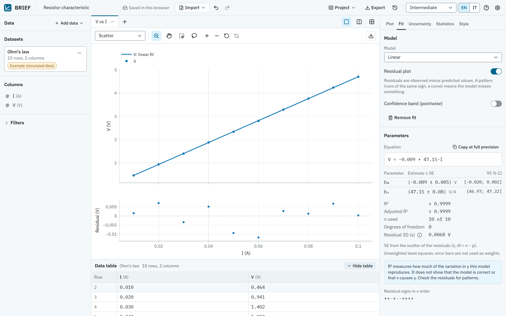
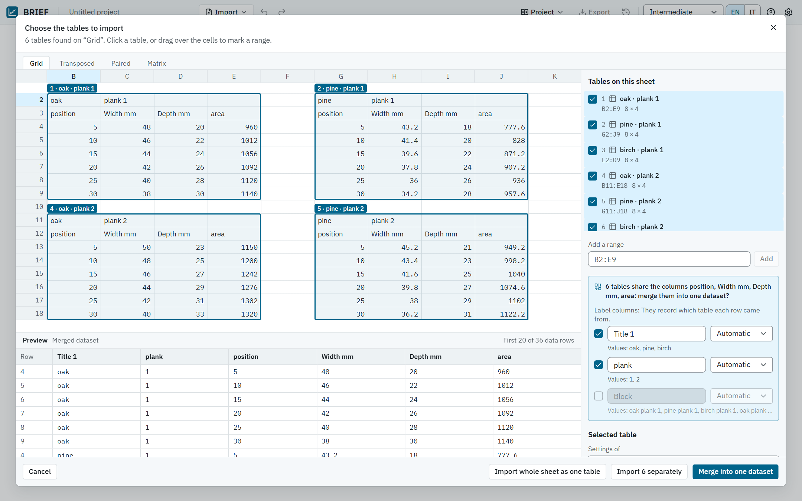
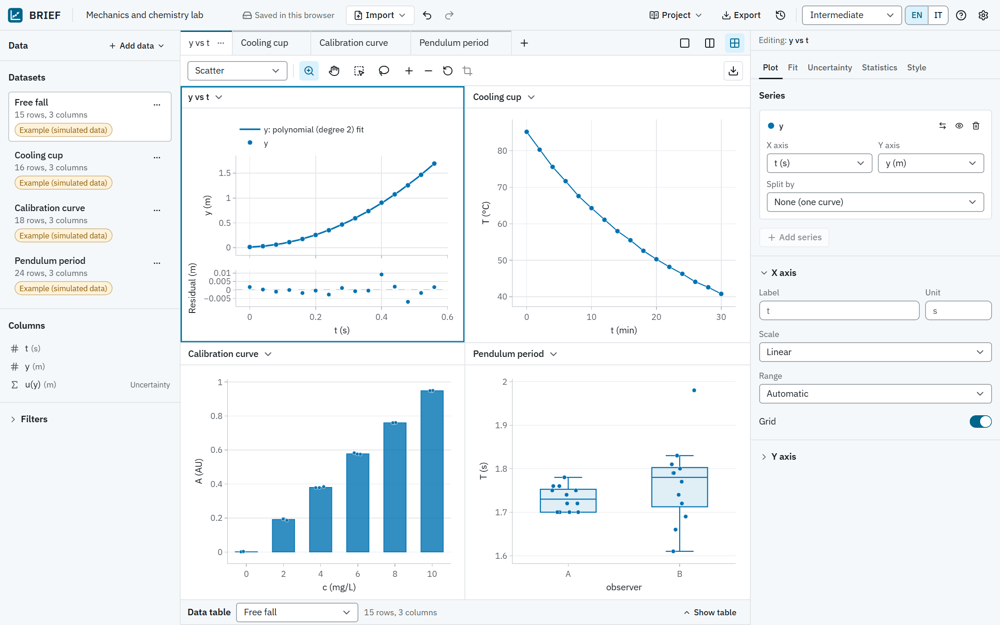
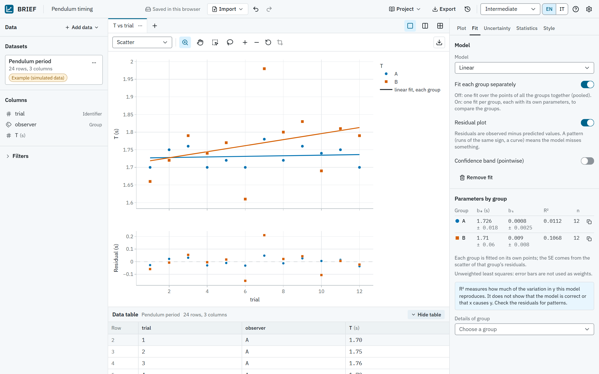
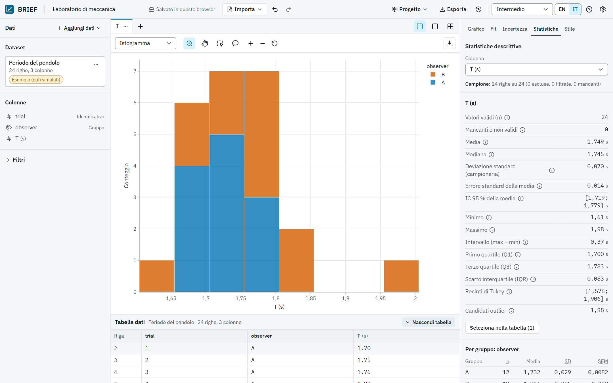

# BRIEF

BRIEF is a free, open-source lab companion for STEM students. Bring a table of measurements, get a
sensible plot straight away, fit a model and show uncertainties honestly. It runs entirely in your
browser: no account, no server, no upload.

[](https://github.com/lucabresciani/BRIEF/actions/workflows/ci.yml)
[](LICENSE)



The interface is available in **English** and **Italian**.

## Why

Lab courses ask students to turn a page of measurements into a plot, a fit and a sentence about
uncertainty. General-purpose spreadsheets make that easy to get subtly wrong, and dedicated
analysis software is often paid, installed per machine or hard to learn. BRIEF aims to be the tool
you can open in a browser five minutes before the lab report is due, and trust.

- **Free and local-first.** Your data stays on your device and is saved in the browser. After the
  first visit the app also works offline.
- **Honest statistics.** The sample is always stated, missing values are never turned into zero,
  nothing is dropped silently, and quantities that are easy to confuse (SD, SEM, confidence
  interval, measurement uncertainty) are labelled differently everywhere they appear.
- **Built for learning.** Every number comes with a short explanation, a recommendation says why a
  plot suits the data, and three experience levels show more or less detail.

## Features

### Import

- Paste cells from Excel, Google Sheets or LibreOffice, or open CSV, TSV and TXT files. The
  delimiter, decimal comma, text encoding, header row, units row and preamble lines are detected,
  and an import preview explains any decision that was ambiguous.
- XLSX, XLS (Excel 97-2003 and 5.0/95) and ODS workbooks, with dates, percentages, merged cells and
  the stored results of formulas (a formula saved without a result is flagged, not guessed). Drop a
  file anywhere in the window to import it.
- **Sheet picker** for workbooks with several small tables on one sheet: every table is outlined,
  including titles, key/value lines and transposed tables. Pick tables by click, keyboard or a
  typed range, then import them separately or merge tables with the same columns into one dataset,
  with label columns that record which table each row came from.
- Every record keeps its position in the original file ("Row 5"), so a point on the plot can be
  traced back to the sheet.
- A **lab notebook** for typing values while you measure, with the plot updating as you go.
- Five example datasets with documented reference values: free fall, Ohm's law, a cooling cup, a
  calibration curve and repeated pendulum timings.



### Plots, tabs and panes

- Scatter, line, bar (mean with SD, SEM or confidence interval per category, with the individual
  observations), histogram and box plot (quartiles of R type 7, Tukey whiskers).
- Several series and datasets on the same axes; linear or logarithmic scales, fixed or automatic
  ranges, titles, legends, markers and line styles.
- Several plots per project in tabs, each with its own type, axes, fits and zoom. Show two side by
  side or four in a grid; a selection is highlighted in every plot of the same dataset.
- Split a series by a column to get one curve per group. Eight colour-blind-safe colours and seven
  marker shapes, so colour is never the only cue.



### Exploration

- Hover for precise values with units and the original row; zoom, pan, box and lasso selection.
- Selection is linked between the plot and the data table in both directions.
- Exclude observations from the analysis without deleting them, with a reason (outlier candidates
  need a note); filter by range or category.
- An operation history with undo and redo.

### Fitting

- Linear and polynomial least squares, plus exponential and power-law fits done by least squares on
  logarithms and labelled as such.
- The equation, parameters with standard errors and confidence intervals, R² and adjusted R² (with
  a caveat about what they do not show), degrees of freedom and the residual standard deviation.
- A residual plot with the sign pattern of the residuals, pointwise confidence and prediction bands,
  and warnings about high-leverage points and poor conditioning.
- A split series can be fitted pooled or **one fit per group**, with a compact table comparing the
  groups. Any fit can be copied at full precision.



### Uncertainty and statistics

- Error bars on x and y: an absolute value, a percentage, a column per row, or two columns for
  asymmetric bars. Their meaning is stated: standard or expanded uncertainty (with the coverage
  factor k), from the instrument or estimated, or explicitly "not stated".
- For replicate measurements, error bars can show the SD, the SEM or a t-based confidence interval
  of each group's mean.
- Descriptive statistics: n, missing values, mean, median, sample SD, SEM, confidence interval of
  the mean, range, quartiles, IQR, Tukey fences and outlier candidates (to investigate, not to
  delete), overall and per group.



### Export, projects and offline use

- Export figures as PNG (at one, two or three times the chosen size) or SVG, and data as CSV: the
  original values or an analysis table with predictions, residuals and in-fit flags, in a standard
  or an Excel-Italian format. When rows are excluded or a fit is shown, the figure caption says so.
- Save a project as a versioned `.sciplot` file with the data, plots, fits, uncertainties,
  exclusions and history; files are validated when opened.
- Work is saved automatically in the browser and restored on reload, with a list of recent
  projects.
- After the first visit the app works offline.

### Learning aids and accessibility

- Beginner, Intermediate and Advanced levels, contextual hints, a help panel on methods and
  conventions, and guided walkthroughs of the Ohm's law and free fall examples.
- A complete English and Italian interface, switchable at any time.
- Keyboard operable throughout, with visible focus and support for reduced motion. The desktop
  layout has resizable panels; tablets and phones get a layout with one section at a time.

## Quick start

You need [Node.js](https://nodejs.org) 24 and npm 11.10 or later (`.nvmrc` names the Node version).

```bash
git clone https://github.com/lucabresciani/BRIEF.git
cd BRIEF
npm ci                 # install exactly the locked dependencies
npm run dev            # development server on http://localhost:5173
```

To build and serve the production version:

```bash
npm run build          # type check, production build and bundle checks, into dist/
npm run preview        # serve dist/ on http://localhost:4173
```

To run the tests:

```bash
npx playwright install chromium   # once, and again after each Playwright upgrade
npm test                          # unit and component tests (Vitest)
npm run e2e                       # end-to-end tests in Chromium (builds first)
npm run verify                    # everything the continuous integration runs
```

`npm run screenshots` regenerates the images in this README from the production build.

`dist/` is a static site that any web server can host. The build uses absolute asset paths, so
serve it from the root of a domain, or set Vite's `base` option for a sub-path.

## Using the app

1. **Bring data.** Paste from a spreadsheet, open a file, start a lab notebook, or try an example.
   If a file was read in a way that needs checking, the import preview explains why; a workbook
   with several tables on a sheet opens the sheet picker.
2. **Look at the first plot.** It appears as soon as the data are read, with a note on why that
   plot type suits them. Change the type, columns and axes in the **Plot** tab of the side panel,
   and add more plots with the **+** next to the tabs.
3. **Explore.** Hover, zoom and select points on the plot or in the table. Exclude a suspicious
   observation with a reason instead of deleting it; it can be restored at any time.
4. **Fit a model** in the **Fit** tab. Read the parameters with their standard errors, then check
   the residual plot for patterns before trusting the result.
5. **Add uncertainties** in the **Uncertainty** tab, saying what the error bars mean, and look at
   the **Statistics** tab for a summary of any column. The Fit and Uncertainty tabs are hidden at
   the Beginner level; the app starts at Intermediate.
6. **Export** a figure or a CSV file, and save the project as a `.sciplot` file to share it or to
   continue on another computer.

The help panel (the **?** in the top bar) explains the methods and conventions in more detail.

## Scientific conventions

- Standard deviations use the sample formula (n − 1).
- Quartiles use R type 7 (the same as Excel's `QUARTILE.INC` and the NumPy default).
- Box-plot whiskers end at the most extreme observations within Q1 − 1.5·IQR and Q3 + 1.5·IQR.
- Histogram bins are [a, b), and the last one is [a, b], so the maximum is always counted.
- Confidence intervals use Student's t with the stated degrees of freedom; a two-sided 95 %
  interval uses t₀.₉₇₅.
- Fits are unweighted ordinary least squares. Parameter standard errors come from the residual
  scatter (s, with df = n − p); error bars are not used as weights, and the interface says so.
- Polynomials are solved by Householder QR on centred and scaled x.
- Exponential and power-law fits are least squares on ln y (and ln x): errors are assumed to be
  multiplicative, R² refers to ln y, and the interval of the prefactor is asymmetric.
- Bands are pointwise. Uncertainties are rounded to one or two significant figures following the
  Particle Data Group rule, and values to the same decimal place.
- Visual settings (log axes, plot type, visibility, style) never change the analysed sample.

## How correctness is checked

- **NIST Statistical Reference Datasets.** The fitting code is compared with the certified values
  of the NIST StRD linear regression datasets, including the ill-conditioned Filip and Wampler
  polynomials, and the statistics code with the univariate datasets. Agreement is measured as the
  number of correct significant digits.
- **An independent oracle.** `scripts/oracle/reference_values.py` uses only the Python standard
  library, with exact rational arithmetic and high-precision decimals, to compute reference values
  for the example datasets, Anscombe's quartet and the Student t critical values. The TypeScript
  results are tested against them.
- **Automated tests.** Unit tests cover the scientific core, component tests cover the interface,
  and end-to-end tests drive the production build in Chromium through import, plotting, fitting,
  uncertainty, export, saving and reopening projects, offline use, the Italian interface and
  keyboard use.
- **Continuous integration.** Every push and pull request runs `npm run verify`: strict type
  checks, linting (including the boundaries between code layers), formatting, all tests, the
  production build with its bundle budget, and the end-to-end suite.

## Architecture

The app is written in TypeScript with React, Vite, Tailwind CSS and Plotly.js. The code is split
into layers whose boundaries are enforced by ESLint:

```
src/domain/     pure TypeScript, no React or DOM: import, statistics, fitting,
                uncertainty, figures, export, project files
src/state/      zustand stores, undo/redo, local persistence
src/plot/       the only module that loads Plotly (a lazily loaded chunk)
src/workers/    file and project parsing off the main thread
src/platform/   browser APIs: IndexedDB, Web Locks, clipboard, files, offline support
src/features/   the React interface
src/i18n/       English and Italian dictionaries, checked for parity by tests
```

Imported data are never modified. Everything on screen (parsed values, samples, fits, statistics,
figures) is derived from the raw data and the project settings.

## Known limitations

- Whitespace-separated `.dat` or `.txt` files are recognised and stopped at the import preview,
  but whitespace cannot be chosen as a delimiter yet: convert the file to CSV or paste it from a
  spreadsheet.
- A header made only of numbers (for example wavelengths as column names) is read as data; set the
  header row in the import preview.
- A unit is read from brackets or a slash ("Width (mm)", "Width / mm"), not from "Width mm".
- Files are refused above 25 MB for text, 20 MB for workbooks, 100 MB for projects or 2 000 000
  cells; a sheet near that size takes a few seconds to open in the sheet picker.
- A fixed range on a date axis is entered as a number (milliseconds since 1970), not as a date.
- Exponential fits with x far from the origin (calendar years, for example) overflow: shift x
  first.
- PNG export uses a fallback font when the browser cannot embed web fonts in the image; SVG export
  keeps the font family.
- Side-by-side panes need a screen at least 1024 px wide; smaller screens show one plot at a time.
- Selecting thousands of points shown in several panes takes most of a second; the focused pane
  responds first.
- Legend entries of histogram groups cannot be hidden with a click.
- The plot toolbar is a row of Tab stops rather than an arrow-key toolbar, and the guided
  walkthrough card can cover controls in the bottom-right corner (Escape closes it).
- The validation summary of a damaged project file uses the schema library's English messages.
- Chromium is tested automatically. Firefox and Safari have not been tested yet.

Not included at the moment: PDF export, nonlinear least squares, weighted regression, uncertainty
propagation through derived columns, unit conversion, code export to Python or R, live sensor
input, collaboration and cloud storage, and a dark theme.

## Contributing

Bug reports, corrections to the science or the wording, translations, tests and code are all
welcome. Please read [CONTRIBUTING.md](CONTRIBUTING.md) for the setup, the checks and the
conventions, and follow the [Code of Conduct](CODE_OF_CONDUCT.md). Report security problems
privately as described in [SECURITY.md](SECURITY.md). Notable changes are listed in
[CHANGELOG.md](CHANGELOG.md).

If you use the app in teaching or research, [CITATION.cff](CITATION.cff) describes how to cite it.

## License

BRIEF is released under the [MIT License](LICENSE). Copyright (c) 2026 Luca Bresciani.

It includes and builds on third-party software and data under their own licences, listed in
[THIRD_PARTY_NOTICES.md](THIRD_PARTY_NOTICES.md). Each production build also writes
`THIRD_PARTY_LICENSES.md` with the licences of every bundled package; the app links to it from
Help → About.

## Credits

Created by [Luca Bresciani](https://luca-bresciani.com), aerospace engineering student.

- Website: [luca-bresciani.com](https://luca-bresciani.com)
- GitHub: [@lucabresciani](https://github.com/lucabresciani)
- LinkedIn: [Luca Bresciani](https://linkedin.com/in/luca-bresciani-62a1313a3)
- X: [@LucasRobotics](https://x.com/LucasRobotics)
- Instagram: [@\_luca_bresciani](https://www.instagram.com/_luca_bresciani/)
- Contact: [luca-bresciani.com/contact](https://luca-bresciani.com/contact)

## Acknowledgements

- The [NIST Statistical Reference Datasets](https://www.itl.nist.gov/div898/strd/), which make it
  possible to check numerical results digit by digit.
- [Plotly.js](https://plotly.com/javascript/), which draws every plot.
- [SheetJS Community Edition](https://sheetjs.com/), which reads the spreadsheet formats.
- The [IBM Plex](https://www.ibm.com/plex/) typefaces, self-hosted through
  [Fontsource](https://fontsource.org/).
- React, Base UI, Papa Parse, zustand, immer, zod, TanStack Virtual and the other open-source
  projects listed in the third-party notices.
